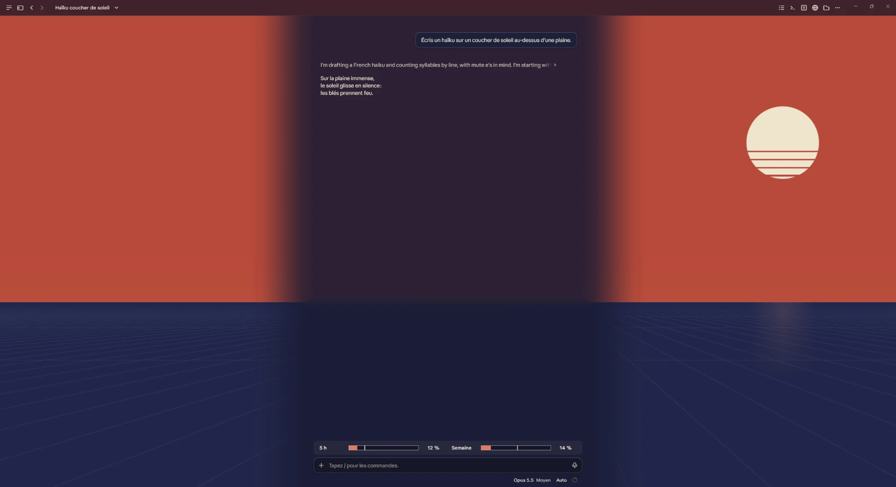

# Horizon : un thème Claude Code qui suit votre session

*An animated Claude Code theme for the desktop app: a cream sun over a navy grid plain under a brick-red sky, played by a GPU shader that follows what the model is doing, how full the context is and how fast you are spending your usage limits.*

Un soleil crème au-dessus d'une plaine marine quadrillée, sous un ciel brique, en formes plates d'esprit sérigraphie rétro. Dans l'app de bureau de Claude Code, un shader redessine la scène et la fait suivre la session : d'un coup d'œil, on voit si Claude travaille, s'il vous attend et où en est le contexte.



## Installer

À l'invite d'une session Claude Code, en deux étapes : ajouter le marché, puis installer le plugin.

```
/plugin marketplace add https://github.com/Marco-Lefrancois/horizon-shader.git
```

```
/plugin install horizon-shader@horizon-shader
```

Choisissez la portée **user** pour que toutes les sessions l'aient. L'adresse HTTPS évite d'avoir besoin d'une clé SSH GitHub. Dans l'app de bureau, `/plugin` ouvre l'écran des plug-ins (Paramètres › Personnalisation › Plug-ins) au lieu de répondre dans la conversation : la première commande peut sembler ne rien faire, mais après la seconde, Horizon apparaît sous « Les vôtres ». Depuis un shell :

```
claude plugin marketplace add https://github.com/Marco-Lefrancois/horizon-shader.git
claude plugin install horizon-shader@horizon-shader
```

Si l'installation répond `Plugin "horizon-shader" not found in any configured marketplace`, c'est que le marché n'a pas été ajouté : faites d'abord la première étape. Les versions récentes de Claude Code acceptent aussi la forme courte `claude plugin install horizon-shader --marketplace Marco-Lefrancois/horizon-shader`, qui ajoute le marché elle-même.

Ouvrez ensuite une nouvelle session dans l'app de bureau et envoyez un premier message : le thème se pose au démarrage de la session.

## Ce que la scène montre

| Ce qui se passe | Ce qu'on voit |
| :--- | :--- |
| Le contexte se remplit | Le soleil descend vers l'horizon, se réchauffe et s'ouvre de fentes ; bandes de couchant et reflet grandissent. Une compaction le fait remonter. |
| Claude travaille (un tour est en cours) | La plaine défile vers vous et la grille passe au corail. |
| Un outil tourne | Des éclats clairs descendent les lignes de fuite. |
| Claude vous attend (une question, un plan à approuver) | La grille s'arrête ; un phare ambre bat lentement au point de fuite. |
| Des sous-agents travaillent | Une étoile s'allume près du soleil pour chacun, jusqu'à quatre. |
| Le dernier tour a fini sur une erreur | La ligne d'horizon rougit jusqu'au tour suivant. |
| Vous consommez la fenêtre de 5 h plus vite que le temps passe | Le ciel fonce vers le prune (de 3 à 12 points d'avance). |

Au-dessus de l'invite, une **bande de consommation** aux couleurs du thème montre les fenêtres de 5 h et de la semaine côte à côte, avec un repère au temps écoulé ; le détail (rythme, projection, réinitialisation) est dans son texte alternatif.

## Commandes

- `/look` : affiche le thème et l'état de l'animation.
- `/look fixe` : aucun mouvement ; l'état reste lisible par les couleurs et la hauteur du soleil. C'est le réglage par défaut.
- `/look anime` : remet le mouvement.
- `/look aucun` : retire le thème ; l'app reprend le sien. `/look horizon` le remet.

Sous « réduire les animations » du système, la scène reste immobile, comme avec `/look fixe`.

## Où il s'affiche

- **App de bureau, onglet Code** : la scène et le shader. Les onglets Conversation et Cowork ne sont pas des sessions Claude Code : le thème ne s'y affiche pas. Là où le shader ne joue pas (version plus ancienne, GPU trop faible), la scène SVG fixe s'affiche seule.
- **Mobile** : la scène.
- **Terminal et éditeurs** : pas de fond ; seule la bande de consommation, en blocs de texte. Pour Windows Terminal, `terminal/install-horizon.ps1` ajoute un jeu de couleurs « Horizon » et un profil « Claude · Horizon » (il sauvegarde chaque fichier avant d'écrire ; `-Uninstall` défait tout).

## Réglages et coût

Le mod n'envoie au shader que des changements d'état (huit valeurs au plus), jamais un flux sur minuterie ; l'app passe d'une valeur à l'autre en douceur. Coût mesuré par `claude plugin validate`, à 30 images par seconde : 1,92 ms par image sur un GPU rapide, 9,96 ms sur un GPU faible.

## Limites connues

- Une demande de permission n'allume pas le phare : aucun événement ne la signale à un mod.
- Le soleil touche l'horizon à 100 % du contexte, alors que la compaction automatique arrive en général avant.
- Un seul thème à la fois : avec un autre mod de thème installé, le dernier posé l'emporte.

## Développer

```
claude plugin validate .
claude plugin test .
```

`hooks/make-colors.js` et `make-colors.d.ts` viennent du skill `plugin-authoring` de Claude Code, recopiés comme il le demande. La seule retouche : un commentaire `gitpilot:allow` sur deux lignes de paliers de gris (« 0 10 20 … 900 »), qu'un contrôle de données personnelles prenait pour un numéro de carte.

## Crédits et inspiration

La scène est un hommage à l'esthétique des affiches et des pochettes de **Tycho** (Scott Hansen), dont le studio de design s'appelle ISO50 : soleils ronds, couleurs sérigraphiées, horizons calmes. Elle est entièrement dessinée pour ce thème. Elle ne reprend aucune œuvre, pochette, affiche, typographie ni logo de l'artiste.

Ce thème est un projet indépendant et non officiel. Il n'est ni affilié à Tycho, à Scott Hansen ou à ISO50, ni approuvé ou commandité par eux. Les noms cités appartiennent à leurs titulaires et servent seulement à nommer l'inspiration.

Pour découvrir son travail : [tychomusic.com](https://www.tychomusic.com) et [iso50.com](https://iso50.com).

## Licence

MIT (voir `LICENSE`).
